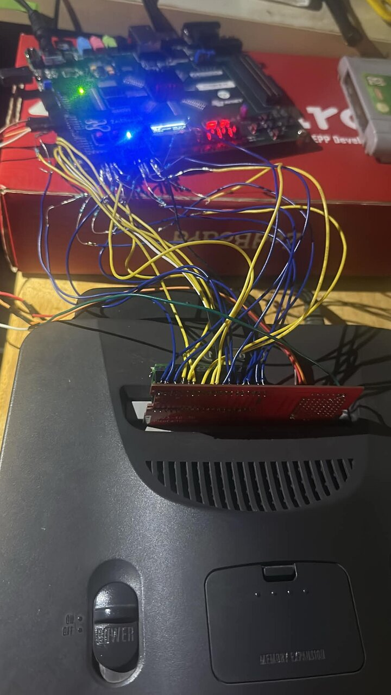

# PicoCart64

Nintendo 64 flash cart using a Raspberry Pi RP2040

Join the Discord server to participate in the discussion and development of this project.

## ZedBoard cart: ROMs up to 64 MB

The RP2040 alone serves ROMs from its flash. For ROMs up to 64 MB, see
[`fpga/zedboard`](fpga/zedboard): a ZedBoard (Zynq-7000) serves ROM, SRAM,
EEPROM and FlashRAM saves and the 64DD disk drive from its DDR memory, and the
Pico on the PicoCart64-lite board only runs the CIC. Games are picked from a
menu on the ZedBoard's OLED or a USB-UART terminal, from ROMs on its SD card.

