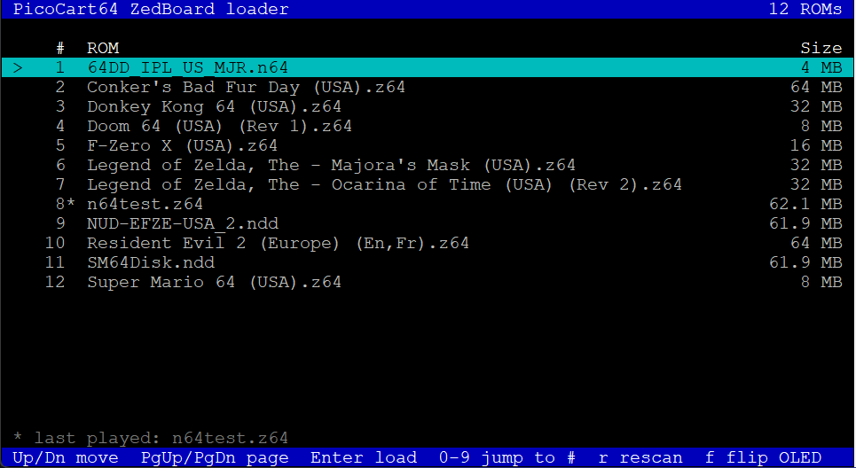
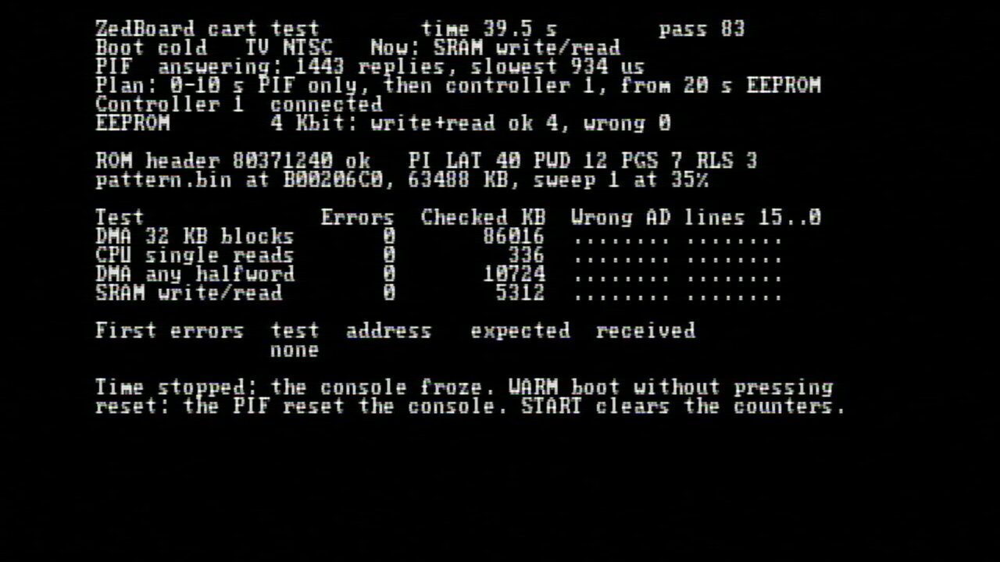
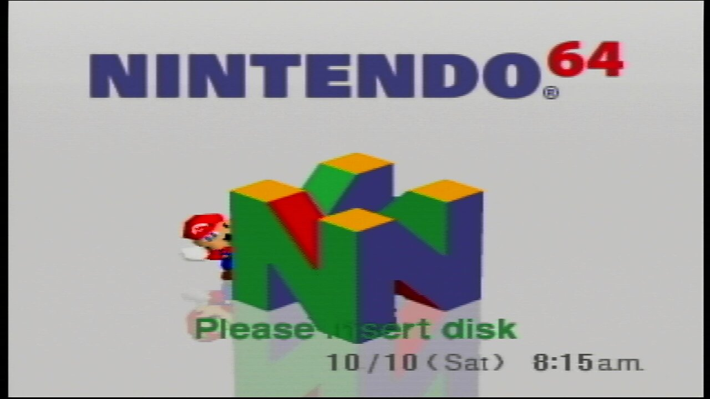
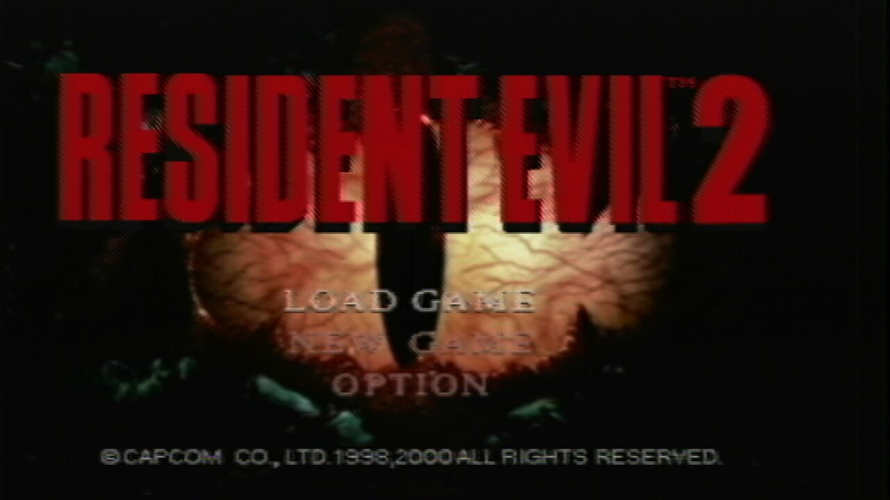
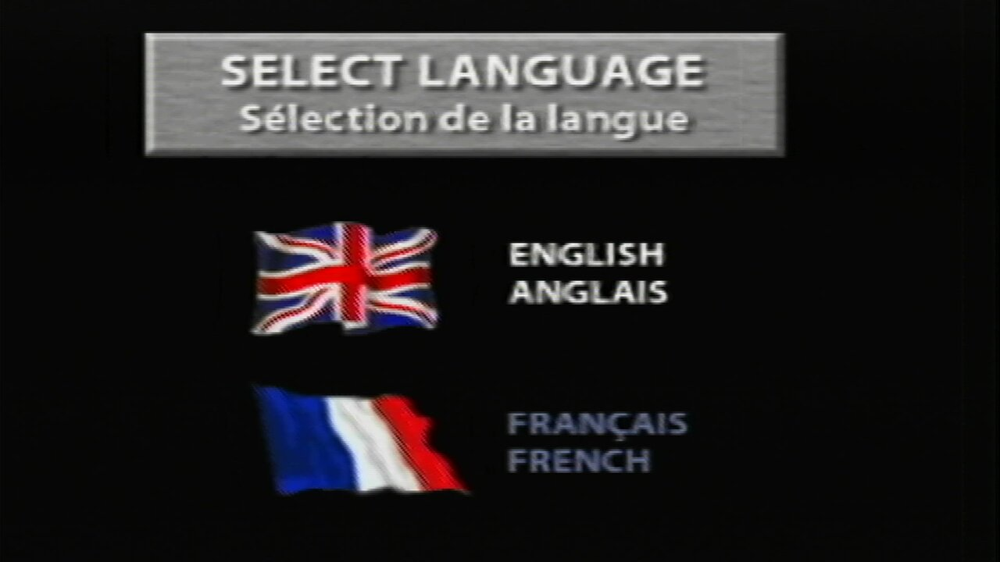
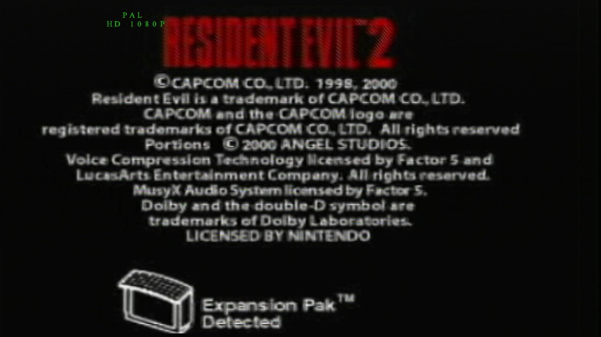

# PicoCart64 + ZedBoard: ROMs up to 64 MB

The ZedBoard serves cartridge ROM, SRAM and EEPROM to the N64. The Pico on the
PicoCart64-lite board only runs the CIC (`sw/picocart64_cic_only`), as the type the
ZedBoard picks for each game, so games of any region and CIC type run on your console.

Games are picked from a full screen menu on the USB-UART terminal or on the
ZedBoard's own OLED with its push buttons. Both show the same menu, so either one
works, and no PC is needed once the board boots from the SD card.

```
N64 cart slot ── PicoCart64-lite v1.4 ──┬── Pico (CIC only: GP20/GP21/GP22)
                                        └── wires ── ZedBoard Pmods JA/JB/JC/JD
```

## Screenshots

| | |
|---|---|
|  |  |
| The loader's menu on the terminal | `sw/n64test` with no errors on ROM, SRAM and EEPROM |
|  |  |
| The 64DD IPL, served and driven by the cart | Resident Evil 2 (Europe), a 64 MB ROM |
|  |  |
| Its language select, past the removed region lock | Its license screen, with the Expansion Pak detected |

## Wiring

Solder wires to the Pico's pins on the Lite board. Add a 33-47 Ω series resistor
on each AD line, close to the ZedBoard end. Keep wires 15 cm or shorter and run
ground wires alongside them.

| Signal      | Pico GPIO | Pico pin | ZedBoard |
|-------------|-----------|----------|----------|
| AD0         | GP0       | 1 | JA1 |
| AD1         | GP1       | 2 | JD7 |
| AD2-AD3     | GP2-GP3   | 4, 5 | JA3-JA4 |
| AD4         | GP4       | 6 | JA7 |
| AD5         | GP5       | 7 | JD8 |
| AD6-AD7     | GP6-GP7   | 9, 10 | JA9-JA10 |
| AD8-AD11    | GP8-GP11  | 11, 12, 14, 15 | JB1-JB4 |
| AD12-AD15   | GP12-GP15 | 16, 17, 19, 20 | JB7-JB10 |
| ALE_L       | GP16      | 21 | JC1 |
| ALE_H       | GP17      | 22 | JC2 |
| ~WRITE      | GP18      | 24 | JC3 |
| ~READ       | GP19      | 25 | JC4 |
| COLD_RESET  | GP22      | 29 | JC7 |
| GND         | GND       | 3, 8, 13, 18, 23, 28 | JA5, JB5, JC5, JA11, JB11, JC11 |

JA2 and JA8 stay empty: on the board this was brought up on, the jumpers there
didn't make reliable contact, so AD1 and AD5 moved to JD7 and JD8.

Four more wires go to the Lite board's headers. These are open drain: the ZedBoard
only pulls them low or lets go, so it never powers the Pico while the N64 is off.

| Signal      | Lite board | ZedBoard |
|-------------|------------|----------|
| S_DAT (EEPROM) | J2 pin 1 (N64_S_DAT) | JD1 |
| CIC type 0  | J1 pin 2 (GPIO26) | JD2 |
| CIC type 1  | J1 pin 3 (GPIO27) | JD3 |
| CIC type 2  | J1 pin 4 (GPIO28) | JD4 |
| /INT1 (64DD interrupt) | J2 pin 4 (N64_INT) | JC9 |
| GND         | any GND | JD5 |

Without the CIC type wires the Pico answers as a 6102/7101, which covers most
games.

S_DAT needs a pull-up on the cart side: the console doesn't pull it up, the same
way each controller pulls up its own line. The FPGA turns on its internal pull-up
(10-50 kΩ) on JD1. Without any pull-up, the PIF hangs at a game's first EEPROM
access, so the game freezes there (Super Mario 64 at its black screen, Conker
after its intro), and the CIC stops getting its checks. If EEPROM games still
freeze, add a 2.2-4.7 kΩ resistor from S_DAT (J2 pin 1) to the cart's 3.3 V
(the Pico's 3V3 pin, 36), not to the Pmod 3V3 pins.

Never connect the Pmod 3V3 pins (6 and 12) to the cart.

**Power order:** turn the ZedBoard on first and the N64 off first. Running the N64
while the ZedBoard is unpowered back-feeds the FPGA through its pins.

The cart only drives AD while COLD_RESET is high, CTRL.enable is set, and the N64
is reading a ROM (`0x10000000-0x1FBFFFFF`) or SRAM (`0x08000000-0x080FFFFF`) address.
An address only counts when ALE_H and ALE_L pulse as long as the N64 makes them
(112 and 224 ns) while ~READ and ~WRITE are idle, so short noise pulses picked up
by the wires are ignored.

## LEDs

| LED | Meaning |
|-----|---------|
| LD0 | Cart enabled by software |
| LD1 | N64 powered (COLD_RESET high) |
| LD2 | ROM access |
| LD3 | SRAM access |
| LD4 | ROM data was late at least once (underrun) |
| LD5 | SRAM written since last clear |
| LD6 | EEPROM access |
| LD7 | EEPROM written since last clear |

## Registers (AXI GP0, base 0x43C00000)

| Offset | Name | |
|--------|------|-|
| 0x00000 | ID | RO, `0x4E363443` |
| 0x00004 | CTRL | bit 0: enable, bit 1: answer as the 64DD, bit 2: no cartridge (leave the ROM addresses alone), bit 3: the SRAM is a FlashRAM chip |
| 0x00008 | ROM_BASE | DDR address of the `.z64` image, 128-byte aligned (default `0x10000000`) |
| 0x0000C | STATUS | bit 0: N64 on, bit 1: SRAM dirty, bit 2: underrun seen, bit 3: EEPROM dirty |
| 0x00010 | CLEAR | write bit 1: clear SRAM dirty, bit 2: clear underrun, bit 3: clear EEPROM dirty |
| 0x00014 | UNDERRUNS | count |
| 0x00018 | LAST_ADDR | last N64 bus address |
| 0x0001C | ADDR_COUNT | address phases seen |
| 0x00020 | BUTTONS | bits 4:0: buttons held, bits 12:8: pressed since last cleared (write 1 to clear). Bit order C, D, L, R, U |
| 0x00024 | OLED_CTRL | bit 0: VDD on, bit 1: VBAT on, bit 2: release RES#, bit 8: busy (RO) |
| 0x00028 | OLED_DATA | WO, sends byte [7:0] to the SSD1306 with D/C = bit 8. Ignored while busy |
| 0x0002C | OLED_FLUSH | WO, sends the frame buffer as display data. Ignored while busy |
| 0x00030 | CIC | bits 2:0: CIC type for the Pico, 1 = line released (default 7) |
| 0x00034 | EEPROM | bit 0: answer on S_DAT, bit 1: 16 Kbit (else 4 Kbit) |
| 0x00038 | MON_ALE | bus monitor: bits 15:0 ALE_H falls, bits 31:16 ALE_L falls |
| 0x0003C | MON_RW | bus monitor: bits 15:0 ~READ pulses, bits 31:16 ~WRITE pulses |
| 0x00040 | MON_FIRST | bus monitor: first address the N64 sent |
| 0x00044 | MON_DATA | bus monitor: first two ROM halfwords as read back from AD, first in bits 31:16 |
| 0x00048 | MON_ROM | bus monitor: bits 15:0 ROM halfwords served, bits 31:16 of those where AD differed from what the cart drove |
| 0x0004C | MON_AD_OR | bus monitor: OR of all address halves, high in bits 31:16, low in bits 15:0 |
| 0x00050 | PINS | live levels: bits 15:0 AD, 16 ALE_L, 17 ALE_H, 18 ~WRITE, 19 ~READ, 22 COLD_RESET, 23 S_DAT |
| 0x00054 | MON_GLITCH | bus monitor: bits 15:0 ALE pulses ignored as noise, bits 31:16 underruns |
| 0x00058 | MON_ODD | bus monitor: bits 15:0 transfers that read an odd number of halfwords, bits 31:16 ~READ low pulses under 150 ns |
| 0x0005C | MON_NOISE | bus monitor: noise events since power on |
| 0x00060 | MON_XFER_N | bus monitor: transfers finished since power on (see XFER) |
| 0x00064-0x0006C | MON_XFER | the transfer in progress: address, {writes, reads}, sum of the halfwords on AD |
| 0x00070 | MON_SDAT | S_DAT monitor: bits 15:0 falls, bits 31:16 EEPROM commands answered |
| 0x00074 | MON_SDAT_LOW | S_DAT monitor: bits 15:0 longest time low, bits 31:16 how long it has been low now, in microseconds |
| 0x00078 | SDAT_LOG_N | events in the S_DAT log (up to 1024) |
| 0x01000-0x011FF | OLED_FB | WO, 512 bytes in SSD1306 horizontal addressing order, byte 4k+j in bits 8j+7..8j of word k |
| 0x02000-0x027FF | EEPROM | 2 KB, packed like the SRAM |
| 0x03000-0x03FFF | TRACE_A | the first 1024 addresses the N64 sent since power on (as many as MON_ALE counted) |
| 0x04000-0x04FFF | TRACE_B | the low half of each address sampled again: 0-10 ns (bits 31:16) and 30-40 ns (bits 15:0) after ALE_L fell |
| 0x05000-0x0503F | NOISE | the first 16 noise events: bits 31:28 type (1 short ALE_H, 2 short ALE_L, 3 odd read count, 4 short ~READ), 27:20 width in 10 ns clocks or the read count, 19:0 microseconds since power on |
| 0x06000-0x06FFF | XFER | the last 256 finished transfers, transfer n in entry n % 256, 4 words each: address, {writes, reads}, sum of the halfwords on AD, microseconds since power on |
| 0x07000-0x07FFF | SDAT_LOG | the first 1024 S_DAT events since power on: bits 31:30 event (0 line fell, 1 line rose, 2 cart pulls low, 3 cart lets go), 29:0 time in 40 ns units |
| 0x08000-0x09FFF | DD | the 64DD (`rtl/dd_asic.v`): sector, C2 and MSEQ buffers at 0x08000, what each ASIC register reads at 0x09000, flags at 0x09080, the N64's register writes as events at 0x09084 |
| 0x20000-0x3FFFF | SRAM | 128 KB. Word k = N64 SRAM bytes 4k..4k+3 as `b0<<24 \| b1<<16 \| b2<<8 \| b3` |

The bus monitor registers (MON_*) and the trace are cleared when the N64 is turned
on and count even while the cart is disabled. Their counts stop at 0xFFFF.

The loader (`sw/loader`) uses these registers to start a game:
1. copies the ROM to DDR at ROM_BASE in `.z64` byte order, converting `.v64`/`.n64` files,
2. flushes the data cache for that range, because HP0 reads bypass the cache,
3. writes the `.sra` or `.eep` save into the SRAM or EEPROM window and sets EEPROM
   to the game's EEPROM size,
4. sets CIC to the game's CIC type and CTRL.enable = 1, then you power on the N64.

`rtl/joybus_eeprom.v` answers the console's EEPROM commands on S_DAT (info,
read and write block) from a 2 KB block RAM that the ARM can also read and write.

The PL only shifts bytes out to the OLED (SPI at 5 MHz, `rtl/oled_spi.v`) and
debounces the buttons (8 ms, `rtl/btn_debounce.v`). The SSD1306 power-up
sequence, settings and orientation are in the loader, so they can be changed
without rebuilding the bitstream.

## Simulation

Needs [Icarus Verilog](https://bleyer.org/icarus/).

```bash
cd fpga/zedboard/sim
iverilog -g2005 -s tb_n64_cart -o tb.vvp tb_n64_cart.v ../rtl/*.v
vvp -n tb.vvp
```

Or with the Vivado simulator:

```bash
xvlog tb_n64_cart.v ../rtl/*.v && xelab tb_n64_cart -s tb && xsim tb -R
```

The testbench uses the N64's real bus timing and a DDR model with 100-300 ns
latency. It checks ROM reads (unaligned, across 4 KB boundaries, at the top of
64 MB, and with back-to-back addresses), SRAM in both directions, banked SRAM,
regions the cart must ignore, bus contention, AXI burst rules and underruns.
It also checks button debouncing, the OLED power pins, command bytes and a full
frame against an SSD1306 receiver model with setup and hold checks, the EEPROM
commands and reply timing against a model of the console's joybus, and the CIC
type lines.

## Building the bitstream

Needs Vivado (the free edition supports the ZedBoard's XC7Z020) and the ZedBoard
board files.

```bash
cd fpga/zedboard
vivado -mode batch -source scripts/create_project.tcl -tclargs build
```

This writes `n64cart.xsa` for Vitis, where the bare-metal loader is built.

## Loader software

`sw/loader/src` is a Vitis standalone (bare-metal) app for the Cortex-A9.

**Set up in Vitis:**
1. Create a platform from `n64cart.xsa`: OS *standalone*, processor `ps7_cortexa9_0`.
2. In the platform's BSP settings, add the **xilffs** library and set `use_lfn` to 1
   (long file names). Without it, only 8.3 names are listed.
3. Create an empty C application on that platform and add all the files in `sw/loader/src`.
4. Build and run it over JTAG (boot mode jumpers JP7-JP11 all to GND), or make a
   `BOOT.BIN` (FSBL + bitstream + app) with *Create Boot Image*, copy it to the SD
   card and set JP9 and JP10 to 3V3 for SD boot. Check the jumpers against the
   ZedBoard user guide.

**SD card:** one FAT32 partition (MBR), with `BOOT.BIN` and the ROMs (`.z64`, `.v64`,
`.n64`) in the root folder. The boot ROM and the loader only use the first
partition. The loader also keeps `n64last.txt` (last game played) and `n64cfg.txt`
(OLED orientation) there.

**Unit tests** for the platform independent parts (any C compiler):

```bash
cd fpga/zedboard/sw/loader/test
cc -I../src -o test_rom_util test_rom_util.c ../src/rom_util.c ../src/cic.c ../src/save_db.c && ./test_rom_util
cc -I../src -o test_ui test_ui.c ../src/menu.c ../src/tui.c ../src/oled_gfx.c ../src/ui.c ../src/rom_util.c ../src/bus_diag.c && ./test_ui
cc -I../src -o test_dd test_dd.c ../src/dd_disk.c ../src/dd_drive.c && ./test_dd
```

`test_ui` covers the menu logic, terminal key decoding, the terminal renderer
(through a small VT100 model), OLED drawing, the menu, loading and game screens,
and the bus diagnosis. `test_dd` covers the 64DD disk geometry and the drive
(commands, the clock, sector reads and writes) against a model of `dd_asic.v`.

## Picking a game

Both menus list the ROMs on the SD card and share one cursor: moving it with the
buttons moves it on the terminal too. The cursor starts on the last game played
(marked `*`).

1. Pick a ROM and press Enter or BTNC. The N64 must be off.
2. Wait for "Cart enabled" (OLED: the game's title), then power on the N64.
3. Saves are written to `<rom name>.sra` next to the ROM, 1 second after the
   game stops writing SRAM. Press `s` or BTNC to save immediately.
4. To change games: power off the N64, then press `m` or BTNL.

**Terminal:** connect to the USB-UART port (J14) at 115200 8N1 with any
ANSI/VT100 terminal, e.g. `picocom -b 115200 /dev/ttyACM0`, `screen`, minicom,
PuTTY or Tera Term. The loader asks the terminal for its size, so the list fills
the window; terminals that don't answer get 80x24. If you connect after the
board has booted, press Ctrl-L to redraw.

| Key | Menu | Game running |
|-----|------|--------------|
| Up / Down | move (wraps around) | |
| PgUp / PgDn, Left / Right | page | |
| Home / End | first / last ROM | |
| 0-9 | jump to that ROM number (type `12` for #12) | |
| Enter | load the ROM | |
| `r` | read the SD card again (after swapping it) | |
| `s` | | save now |
| `m` or Esc | | back to the menu (N64 off) |
| `f` | turn the OLED by 180 degrees | same |
| `t` | | print the address trace and the noise log (see Troubleshooting) |
| Ctrl-L | redraw the screen | same |

**OLED and buttons:** the OLED shows 3 ROMs at a time, without the file
extension. Names that don't fit scroll on the selected line.

| Button | Menu | Game running |
|--------|------|--------------|
| BTNU / BTND | move (hold to repeat) | |
| BTNL / BTNR | page | BTNL: back to the menu (N64 off) |
| BTNC | load the ROM, or read the SD card again if it has no ROMs | save now |
| BTNL + BTNR together | turn the OLED by 180 degrees | |

Errors and warnings appear on the terminal's status line and for a few seconds
over the OLED list; any button clears them. The OLED switches off after 5
minutes without keys, buttons or messages, and the next button press only
wakes it up.

The buttons are on bank 34, which runs at VADJ. The constraints assume jumper
J18 is in its default 2.5 V position.

## CIC and region

The loader identifies each game's CIC from its boot code: 6101, 6102/7101, 7102,
6103/7103, 6105/7105 or 6106/7106. It puts the type on the CIC type lines, and the
Pico reads them as the N64 leaves reset. Games with an unknown boot code get the
6102, with a warning.

The region that matters is your console's, not the game's: build the Pico firmware
with `-DREGION=NTSC` for an NTSC N64 or `-DREGION=PAL` for a PAL one (see
`sw/README.md`), and games from any region boot. PAL releases still choose their
own video mode, and many output 50 Hz PAL video, which some TVs show in black and
white or can't show at all. The loader notes when a ROM is a PAL release.

Some games also check the console's region in their boot code and stop forever
on the wrong one, before they turn on the video (blue screen): Resident Evil 2
(Europe) loops at `0x8000057C` unless the console is PAL. The loader removes such
checks from the copy in DDR (a read of the TV type at `0x80000300` followed by a
branch to itself on it becomes a NOP), updates the header checksum the boot code
checks, and logs "Removed 1 region lock from the boot code". The ROM file on the
SD card isn't changed.

## 64DD

The cart can also be the 64DD disk drive. It answers the drive's registers and
buffers at `0x05000000` and serves the 64DD IPL ROM at `0x06000000`; the loader
emulates the drive (`sw/loader/src/dd_drive.c`, after ares) in the interrupt of
the cart's events, with the disk in DDR. It needs:

- the `/INT1` wire (table above), which the drive uses to interrupt the N64
- the Pico firmware with the 64DD CIC codes (`sw/README.md`)
- on the SD card: your 64DD IPL ROM dump (any `.n64`/`.z64` whose header says
  NDD, e.g. the US development IPL `NDDE` or the Japanese `NDDJ2`) and `.ndd`
  disk images (64,931,840 bytes)

| Pick in the menu | What the N64 boots |
|---|---|
| a `.ndd` disk | the 64DD IPL ROM with that disk, no cartridge |
| a game, with a disk still in the drive | the game, with the 64DD and the disk attached (F-Zero X with the Expansion Kit) |
| the IPL ROM itself | the IPL with whatever disk is in the drive, or none |

So for a disk that works with a cartridge, pick the disk, go back to the menu
(`m`) and pick the game. The disk stays in the drive until `e` takes it out
(in the menu, or with the N64 off). Disk writes go back to the `.ndd` file 1 s
after the game stops writing, and when you leave the game. The drive's clock
starts at the loader's build time.

Region: like a real drive, the IPL may refuse disks of another region (a US IPL
and a Japanese disk).

## Saves

The loader looks up each game's save type in a built-in list (`sw/loader/src/save_db.c`,
from the ares emulator) and keeps the save next to the ROM:

| Save type | Games (examples) | File |
|-----------|------------------|------|
| SRAM 256 Kbit / 768 Kbit | Resident Evil 2, Ocarina of Time, Smash Bros. | `<rom name>.sra` |
| EEPROM 4 Kbit | Super Mario 64, Mario Kart 64, GoldenEye 007 | `<rom name>.eep` |
| EEPROM 16 Kbit | Conker's Bad Fur Day, Perfect Dark, Banjo-Tooie | `<rom name>.eep` |
| FlashRAM | Majora's Mask, Paper Mario, Pokemon Stadium | `<rom name>.fla` (128 KB) |

Saves are written 1 second after the game stops writing, and when you press `s`
or BTNC. FlashRAM games find a Macronix MX29L1101 (`rtl/flashram.v`, after ares): its
commands, page programming and erases work on the cart's 128 KB of save memory.
For a game that isn't in the list, the cart offers both a 4 Kbit EEPROM
and SRAM, and keeps whichever the game writes. An existing 2 KB `.eep` file makes
its EEPROM 16 Kbit. The `.eep` files hold the EEPROM bytes in order, the same
layout most emulators use.

## Troubleshooting

Every boot starts the same way: the console's PIF checks the CIC, then the CPU
reads the ROM header at `0x10000000`, the boot code one word at a time (about
1009 addresses), and the first 1 MB of the game (2048 more addresses).

The cart's bus monitor records this from the moment the N64 is turned on, even
while the cart is disabled. The game screen on the terminal shows its counts on
the `Bus` and `Addresses` lines, and 2 seconds after power on the loader logs how
far the boot got. The OLED scrolls the same message.

| Message | What to check |
|---------|---------------|
| No bus activity | The N64 stopped before it read the cart. Usually the CIC handshake failed: the Pico's LED stays off (`sw/README.md`) when it has no power, runs other firmware, or the PIF rejected the CIC (`REGION`, or the cart isn't fully seated). If the LED is on, check the ALE_L, ALE_H and ~READ wires (JC1, JC2, JC4) and the ground wires |
| ALE_L or ALE_H never toggles, or they look swapped | JC1 and JC2 |
| No ~READ pulses, or ~READ and ~WRITE look swapped | JC3 and JC4 |
| First address ..., check ADn (JAx) | The AD wires that read wrong in the first address |
| ROM reads didn't match what the cart drove | Something else drives AD: the Pico with other firmware, or AD wires touching each other |
| Never high in any address: ADn | That AD wire is open or stuck low |
| Stopped while reading the boot code | AD wires, then the Pico |
| Boot code read, then the N64 stopped | The PIF's CIC check failed: the CIC type (JD2-JD4 wires), or wrong data on the AD wires |
| The game's first 1 MB loaded, then the N64 stopped | The boot code's checksum of the game failed: wrong data on the AD wires |
| Bus OK | The N64 runs the game from the cart. A black screen then is a video problem, e.g. a PAL game on an NTSC TV |
| Ignored n short pulses on ALE_L/ALE_H as noise | The cart rejected them, but they come from noise on the wires: add or shorten ground wires |
| ~READ noise: n transfers read an odd number of words | Extra ~READ pulses made the cart skip words. The boot only reads whole words and pages, so an odd count is noise on JC4: improve the ground wires |
| n ROM words were late | The N64 read before the data was ready and got wrong data |
| S_DAT ... held low for n us | The EEPROM line stayed low, which stops the PIF: the game freezes at its next controller or save access, and the CIC stops getting its checks. S_DAT needs a pull-up (see the wiring notes) |

When the boot stops after the N64 started reading, the loader also checks the
address trace. The boot code is read at `0x10000040`, `0x10000044`, ...
`0x10000FFC`, a binary count on AD2-AD11, so every input that doesn't follow its
own line shows up:

| Message | Meaning |
|---------|---------|
| Wiring: JD7 (AD1) follows AD2 (Pico pin 4) | The wire on JD7 reaches the AD2 line instead of AD1, or touches it |
| Wiring: JD8 (AD5) stuck at 0 | That wire is open or shorted to ground |
| Wiring: ... wrong in n of 1009 | That input is unstable: a bad joint, or a floating wire |
| Low half wrong ... before ALE_L fell, 0 just after | The wires are right but the address changes too close to ALE_L for the sampling point |

LD2 only lights for addresses in the ROM range, so it stays off both when the
N64 stops before reading the cart and when the address wires are wrong.

## Test ROM

`sw/n64test` is an N64 program that tests the cart from the console's side and
shows the results on the TV. It builds with libdragon, in the toolchain's Docker
image (the image has the compiler; libdragon itself is built into it once):

```sh
git clone https://github.com/DragonMinded/libdragon
docker run -d --name n64dev -v $PWD/libdragon:/libdragon \
    -v $PWD/fpga/zedboard/sw/n64test:/work ghcr.io/dragonminded/libdragon:latest sleep infinity
docker exec n64dev sh -c 'cd /libdragon && ./build.sh'
docker exec --user $(id -u):$(id -g) -w /work n64dev make
```

Copy `n64test.z64` (62 MB, CIC 6102) to the SD card and pick it like a game. It
loops forever and shows:

| Line | Meaning |
|------|---------|
| `time`, `pass` | Count while the console runs. If they stop, the console froze |
| `Boot WARM` | The console restarted. Without the reset button, the PIF reset it |
| `Now:` | The test running. On a frozen screen, the test that was running |
| `DMA 32 KB blocks` | 62 MB of pattern, 1 MB per pass, read the way games load data |
| `CPU single reads` | Random words, one address per word |
| `DMA any halfword` | Short DMAs of any even length at any even address |
| `SRAM write/read` | 32 KB at `0x08000000`, written and read back |
| `PIF` | The PIF, which also checks the CIC, is asked every 20 ms: only empty requests for the first 10 s, then controller 1 reads, and EEPROM tests from 20 s. When it stops answering, the line shows when and during what |
| `Controller 1`, `EEPROM` | What answered through the PIF. The EEPROM test writes 8 bytes and reads them back every 5 s |
| `Wrong AD lines` | `X` marks each AD line that carried a wrong bit |
| `First errors` | Address, expected and received word (halfword for `HALF`) |

START on controller 1 clears the counters.

PIF requests time out after 200 ms, so the test keeps running when the PIF
stops. The cart tests then go on for 3 s and stop with three reads the ZedBoard's
transfer log (`t` key) shows: `0x13E00000`, then `0x13E00000 + 4 × (1 + kind)`
for what the PIF was asked (0 empty, 1 controller, 2 EEPROM info, 3 EEPROM
write, 4 EEPROM read), then `0x13E10000 + 4 × (time / 10 ms)` for when it stopped.
